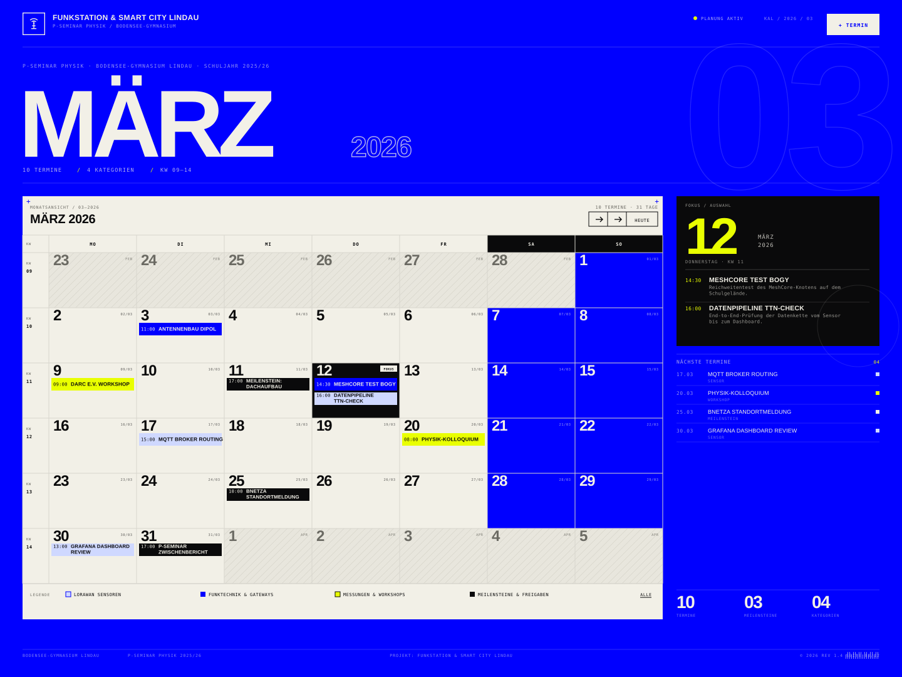

# Design System — Funkstation & Smart City Lindau

**Art direction:** Swiss industrial print on electric blue.

A project calendar that reads like a technical print artefact: blueprint field, cream paper panel,
hairline grid, compressed display capitals and page-after-page of tiny monospaced metadata.
Nothing is rounded, nothing floats, nothing glows. Structure comes from rules, fills and type — not
from cards or shadows.

- **Figma:** [Ohne Namen](https://www.figma.com/design/pkBa0cqHEYWavnnq9bQ4cH/Ohne-Namen) — file key `pkBa0cqHEYWavnnq9bQ4cH`
- **Canonical artboard:** `kalender-page 1` — node `11:11770`, 1440 × 1080
- **Implementation:** [kalender.html](kalender.html), [assets/kalender/kalender.css](assets/kalender/kalender.css)
- **Static reference:** [kalender-page.svg](kalender-page.svg)



> The Figma file also contains an earlier white/blue calendar variant built with Space Grotesk /
> Space Mono (`Html → Body`, nodes `11:132` and `11:560`). That variant is **not** the system.
> The print-style artboard above is the source of truth; this document describes it and the
> production CSS that implements it.

---

## 1. Principles

1. **Print first, screen second.** Issue numbers, registration crosses, barcodes, microtype and
   tabular figures are part of the layout, not decoration added afterwards.
2. **One field, one object.** The blue is the page. The cream panel is the document placed on it.
   Do not introduce a third surface.
3. **Rules over containers.** Hairlines, grid gaps and inverted cells do the work that borders,
   radii and shadows do elsewhere. Radius is always `0`.
4. **Data is the ornament.** Huge outlined numerals, week codes and counts are the visual interest;
   no illustrations, no icon sets, no gradients.
5. **Every label is a form field.** Uppercase German, letter-spaced, 6–9 px, set in mono. Display
   type is reserved for numbers, month names and headlines.
6. **Colour is categorical, never decorative.** Four event categories own four fills. Yellow is an
   alarm/accent, not a background.

---

## 2. Colour

### Core palette

| Token | Hex | Role |
|---|---|---|
| `--blue` | `#0000FF` | Page field, primary accent, sensor ink |
| `--paper` | `#F2F0E7` | Calendar surface, text on blue, inverted text |
| `--ink` | `#0A0A0B` | Text on paper, focus card, milestone fill |
| `--muted` | `#6B6A63` | Secondary metadata on paper |
| `--signal` | `#E9FF00` | Live dot, counters, separators, workshop fill, focus numeral |
| `--lavender` | `#CFD8FF` | Sensor event fill (only tinted surface allowed) |
| `--rule` | `#D8D6CD` | Grid hairlines inside the paper panel |
| `--blue-deep` | `#001E88` | Weekend cell overlay in the artboard |
| `--blue-ink` | `#0000D6` | Weekend hover state in the web build |

Reserve values present in the file but not used on the artboard: `#004CFF`, `#FF3B30`.
Do not promote them into the system without a new decision.

### Measured contrast (WCAG 2.1)

| Pair | Ratio | Verdict |
|---|---|---|
| Paper `#F2F0E7` on blue `#0000FF` | **7.53:1** | AAA |
| Ink `#0A0A0B` on paper `#F2F0E7` | **17.33:1** | AAA |
| Blue `#0000FF` on paper | **7.53:1** | AAA |
| Muted `#6B6A63` on paper | **4.76:1** | AA normal text |
| Signal `#E9FF00` on blue | **7.68:1** | AAA |
| Signal `#E9FF00` on paper | **1.02:1** | Never text |
| Paper at 86 % on blue | 5.60:1 | AA |
| Paper at 72 % on blue | 4.10:1 | Large text only |
| Paper at 62 % on blue | 3.21:1 | Non-essential only |
| Ink at 42 % on paper | 2.83:1 | Non-essential only |

### Usage rules

- **Blue is the field, cream is the document.** Aim for roughly 55 % blue / 35 % paper /
  10 % signal + ink. Blue never appears as a small decorative shape on cream except as type
  and the 3 px category bar.
- **Opaque category fills only.** Sensor `lavender`, Funk `blue`, Workshop `signal`,
  Milestone `ink`. No borders around chips; category is carried by the fill, with the 3 px blue
  leading bar reserved for sensor entries.
- **Yellow is not a highlighter.** Use it for the live dot, the `/` separators, the week marker,
  focus numerals and the workshop fill. Never set yellow body text on cream.
- **Hairlines:** `#D8D6CD` on paper in print, `rgba(242,240,231,.32)` on blue for structural
  rules, and `rgba(0,0,255,.26)` for the 1 px calendar gaps in the web build.
- **Selection:** 2 px inset ink border on paper; never a soft ring or drop shadow. (The current
  web build uses a full ink cell instead — see §5.)

---

## 3. Typography

### Families

| Role | Family | Weights / axes | Notes |
|---|---|---|---|
| Display | **Archivo** | 700 / 800 / 900, width 100–112 % | Month, day numbers, focus date, stats, wordmark |
| Everything else | **IBM Plex Mono** | 400 / 500 / 600 | Labels, metadata, event copy, buttons, footer |

Load exactly those weights. Fallbacks: `"Segoe UI", system-ui, sans-serif` and
`"Cascadia Mono", Consolas, monospace`. Never substitute a third family.

### Scale at the 1440 × 1080 artboard

| Role | Face | Size | Line | Tracking | Case | Colour |
|---|---|---|---|---|---|---|
| Ghost month index (`03`) | Archivo 700 | 330 | 0.72 | −0.10 em | — | outline 1 px paper @ 16 % |
| Hero month (`MÄRZ`) | Archivo 900 · w112 | 152 | 0.76 | −0.065 em | UPPER | paper |
| Focus day (`12`) | Archivo 900 · w110 | 82 | 0.72 | −0.075 em | — | signal |
| Hero year (`2026`) | Archivo 600 | 46 | 1.00 | −0.03 em | — | outline 1.5 px paper @ 72 % |
| Stat number | Archivo 800 · w104 | 28 | 0.88 | −0.055 em | — | paper / ink |
| Day number | Archivo 800 · w104 | 24 | 0.86 | −0.055 em | — | ink |
| Section title (`MÄRZ 2026`) | Archivo 700 | 20 | 1.00 | −0.025 em | UPPER | ink |
| Wordmark | Archivo 700 · w108 | 12 | 1.00 | 0.055 em | UPPER | paper |
| Focus event title | Archivo 700 · w104 | 10.5 | 1.15 | 0.015 em | UPPER | paper |
| Dialog title | Archivo 800 · w108 | 20 | 1.00 | −0.02 em | UPPER | paper |
| Event title | IBM Plex Mono 600 | 8.4 | 1.16 | 0.005 em | UPPER | per fill |
| Button label | IBM Plex Mono 500/600 | 9 | 1.00 | 0.11 em | UPPER | per variant |
| Hero meta (`10 TERMINE / …`) | Plex Mono 400 | 8.5 | 1.35 | 0.14 em | UPPER | paper @ 72 % |
| Micro label / eyebrow | Plex Mono 400/500 | 7.5–8 | 1.35 | 0.16 em | UPPER | muted / paper @ 86 % |
| Event time | Plex Mono 500 | 7.2 | 1.10 | 0.02 em | — | inherited @ 72 % |
| Footer / day code | Plex Mono 500 | 6–6.5 | 1.00 | 0.06–0.12 em | UPPER | muted / ink @ 57 % |

The artboard sets display type in Archivo Bold 700; the screen build uses 800/900 for the same
heavy compressed caps at large sizes. Both read as one weight system — do not introduce a light
or regular display cut.

### Type rules

- **Numbers are tabular** everywhere: `font-variant-numeric: tabular-nums`. Dates never shift
  width between months.
- **Display sizes are clamped on screen:** hero `clamp(82px, 10.6vw, 158px)`, focus day `82px`,
  stat `28px`. Do not scale microtype up with the viewport.
- **Outlines instead of grey type.** Secondary large numerals (`2026`, ghost `03`) are transparent
  fills with a paper stroke, not reduced-opacity text.
- **German labels, telegraphic style.** `TERMINRASTER`, `PLANUNG AKTIV`, `AKTUELLER TAG`,
  `10 TERMINE`, `KW 09—14`. Uppercase, no terminal punctuation, no exclamation marks.
- **Separators:** ` / ` for metadata groups, ` · ` inside prose metadata, ` — ` for ranges,
  ` // ` for the project strapline. Slashes in the signal colour when they sit on blue.
- **Line breaking:** event titles clamp at two lines. Never let a day cell push the grid row.

---

## 4. Layout

### Artboard

```
1440 × 1080
├ 36 px outer margin
├ header            64 px tall, 1 px rule under
├ hero band          ≈ 217 px (overlaps a 330 px ghost numeral)
├ hairline at y 292
└ workspace          y 313 → 988
   ├ calendar panel  1022 px
   ├ gutter            22 px
   └ rail             324 px
footer                6.5 px type, rule above
```

`36 + 1022 + 22 + 324 + 36 = 1440` — the workspace is the page width minus margins, with the
rail as a fixed 324 px column.

### Calendar grid

| Property | Value |
|---|---|
| Columns | `42px` week gutter + `7 × 140px` |
| Rows | `28px` weekday head + `6 × 88px` |
| Gaps | `1px` — `--rule` in the artboard, `rgba(0,0,255,.26)` in the web build |
| Cell padding | `8px` (Figma) / `5px` (web) |
| Weekday head | blue, paper text; weekend head ink |
| Week number | stacked `KW` (5.5 px) over `09` (9 px), centred |

### Spacing scale

`1 · 2 · 3 · 4 · 5 · 6 · 8 · 10 · 12 · 14 · 16 · 20 · 22 · 24 · 26 · 32 · 34 · 36 · 64`

Base unit 2 px. Above 8 px, prefer multiples of 4. Padding inside cells is intentionally tight;
space is expressed by the grid, not by generous margins.

### Radii, borders, elevation

- Radius: `0` on every element, including buttons, chips, dialog and inputs.
- Borders: exactly `1px`, always solid, always axis-aligned.
- Elevation: none, except the optional hard offset shadow `2px 2px 0 var(--ink)` on the primary
  button at poster scale. Never a blurred shadow.
- Texture: a single fixed `soft-light` grain at ≈ 5.5 % opacity layered above the content,
  `pointer-events: none`. Never tint the grain or animate it.

### Responsive behaviour

| Breakpoint | Behaviour |
|---|---|
| ≥ 1181 px | Full artboard: calendar + 324 px rail |
| ≤ 1180 px | Rail drops below calendar, becomes a 2-column block (`1.15fr 1fr`), stats span full width |
| ≤ 900 px | Live status and doc code hide, footer centre group hides, legend tightens |
| ≤ 760 px | Month grid is replaced by a chronological agenda list; ghost numeral hidden; hero clamps to 62–92 px |
| ≤ 420 px | Compact masthead and single-column controls |
| print | A4 landscape, white ground, grid retained, rail/tools/grain/buttons hidden, selection forced to grey |

Shell: `width: min(100%, 1540px)`, padding `26px 36px 22px`.

---

## 5. Components

### Masthead
Cream-on-blue, 64 px tall, 1 px bottom rule. Left: 34–38 px stroke-only radio-tower mark, wordmark
(12 px Archivo) and strapline (7.5 px mono). Right: live status with 6 px blinking yellow square,
document code (`KAL / 2026 / 03`), solid paper button. No navigation bar, no logo lockup beyond this.

### Hero
Eyebrow → month (Archivo 900, uppercase) + outlined year baseline-aligned → stats row with signal
slashes. Giant outlined index numeral bleeds off the top-right corner at 1 px / 16 % stroke and
never interacts with the pointer. Month label is the largest element on the page; the year is
always outlined, never filled.

### Calendar panel header
Two-part: left `MONATSANSICHT / 03—2026` + `MÄRZ 2026`; right `10 TERMINE · 31 TAGE` plus
stepper and today controls. The stepper is a 1 px outlined group of 27 px squares (12 px arrow
glyphs, mono 9 px `HEUTE`), with zero gap between segments and a blue hover fill.

### Day cell
Structure: top row `day-num` (24 px Archivo) and `day-code` (`12/03` or `MÄR` style code, 6 px
muted); flexible middle; events anchored bottom. States:

| State | Treatment |
|---|---|
| Default | paper, ink |
| Hover | `--paper-dim` `#E7E4D8` |
| Weekend | blue fill, paper text, events invert |
| Outside month | diagonal 1 px hatch (`6px` paper-dim / `7px` paper), 34 % ink text, 17 px numerals, non-interactive |
| Today | 3 px signal underline on the day number (web build) |
| Selected | Artboard: 2 px inset ink border, cream ground kept. Web build: full ink inversion, signal numeral, `FOKUS` tag |

The selection treatment is the one place where artboard and build diverge. The 2 px inset border
is canonical for new work — it keeps the grid readable; the ink inversion is an accepted
current-state variant that should be unified when the calendar is next touched.

### Event chip
Grid `30px time + 1fr title`, min-height 21 px, padding `2px 4px 3px`. Time at 7.2 px at
72 % opacity; title 8.4 px uppercase mono, clamped to two lines. No icon, no radius, no border
on the trailing edges. The 3 px leading bar is reserved for the sensor chips (blue on the pale
tint); the other categories carry their identity through fill alone.

| Category key | German label | Fill | Text | Bar |
|---|---|---|---|---|
| `sensor` | LoRaWAN-Sensoren | `#CFD8FF` (web: `rgba(0,0,255,.075)`) | ink | blue 3 px |
| `funk` | Funktechnik & Gateways | `#0000FF` | paper | — |
| `workshop` | Messungen & Workshops | `#E9FF00` | ink | — |
| `milestone` | Meilensteine & Freigaben | `#0A0A0B` | paper | — |

### Legend
`LEGENDE:` label followed by four 8–9 px square swatches + 7 px labels, 18 px column / 9 px row
gaps, 10–11 px vertical padding, 1 px top rule.
Interactive: pressed state is full opacity, unpressed drops to 42 % with a 1 px line-through. A
reset action with a 1 px underline sits at the trailing edge. Swatches are 1 px outlined; only the
sensor swatch is a pale tint, never a filled lavender square.

### Focus card (rail)
Ink block, no radius. Signal 82 px day number + `MÄRZ / 2026` stacked mono; meta line
(`DONNERSTAG · KW 11`); the day's events separated by 1 px rules with signal times; a 130 px
1 px-stroked circle ornament clipped at the bottom-right corner. Empty state: dashed 1 px box.

### Upcoming list (rail)
Rows `44px date · title · 6px dot`, 1 px hairlines, 8 px vertical padding. Date in mono at 58 %
paper, title 9 px mono, dot in the category colour. Hover shifts title to signal.

### Stats strip (rail)
Three equal columns, 1 px dividers: 28 px Archivo number over 6 px label. Values: `10 TERMINE`,
`03 MEILENSTEINE`, `04 KATEGORIEN`.

### Footer
Three groups: school + seminar, project strapline, document marker/barcode. 6.5 px mono at 52 %
paper, 1 px top rule, 10 px padding. Barcode is a CSS repeating gradient (web-only ornament);
in print use a real registration mark instead.

### Dialog
460 px max, paper surface, 1 px ink border, radius 0, no shadow. Backdrop `rgba(0,0,255,.82)`
with 3 px blur. Header is a blue bar with a 20 px Archivo title; fields are 36 px boxed inputs
with a 1 px ink border, 10 px mono text and a blue inset focus outline.

### Buttons
38 px min-height, `0 16px` padding, 1 px border, radius 0, mono 9 px uppercase at 0.11 em.

| Variant | Default | Hover |
|---|---|---|
| Solid | paper fill, blue text | signal fill, ink text |
| Outline (on blue) | transparent, paper border/text | paper fill, blue text |
| Blue (on paper) | blue fill, paper text | ink fill, paper text |

---

## 6. Iconography & ornament

- **Stroke-only line work**, 1.5 px, square caps, no fills. The brand mark (radio tower in a square)
  is the only logo; it is never coloured, only currentColor.
- **Registration crosses** (`+`) sit at the corners of the calendar panel, 11 px mono, blue on paper.
- **Hairline geometry:** full-bleed verticals between week columns, horizontals between weeks, and a
  single rule above the legend. Do not use dashed rules except for empty states.
- **Ornaments are measurable objects:** ghost index numerals, circled focus ornament, barcode,
  week numbers. No stock imagery, no emoji, no decorative blobs.
- **Photography**, if ever introduced, is duotone blue/ink with a visible halftone dot — never full
  colour.

---

## 7. Motion

- Easing: `cubic-bezier(.22, .68, .16, 1)` for all transitions.
- Durations: 150–180 ms for hover/focus colour shifts; no layout animation.
- One ambient animation only: the 6 px live dot blinks in `steps(1, end)` on a 3.2 s cycle.
- Nothing animates on load. No parallax, no scroll reveals.
- `prefers-reduced-motion: reduce` disables the blink and all transitions.

---

## 8. Voice & content

- German UI copy, uppercase for labels, sentence case only inside running descriptions.
- Terse, technical, no marketing superlatives: `PLANUNG AKTIV`, `AKTUELLER TAG`,
  `10 TERMINE · 31 TAGE`, `PROJEKT: FUNKSTATION & SMART CITY LINDAU`.
- Dates: `DD.MM.` in lists, `DD/MM` in day codes, `KW 09—14` for week ranges with an em dash.
- Use `MÄRZ`, `MÄR`, `MÄRZ 2026` — never `Maerz` or `March` in the interface.
- Counts are always written as two digits when they sit in display type: `03`, `04`, `10`.

---

## 9. Accessibility

- **Contrast:** the core pairs pass AA/AAA (see §2). Structural hairlines are exempt as decoration.
- **Translucent type is a print register, not a text colour.** Anything a user must read to act
  should use solid paper/ink or paper at 86 % on blue (5.6:1). The 48–62 % values in the artboard
  are for non-essential meta; do not reuse them for controls or event copy.
- **Microtype tension:** the 6–9 px scale is deliberate. Keep essential interactive labels
  (buttons, filters, agenda titles) at ≥ 11 px on screen, and never rely on size alone to signal
  hierarchy — use case, weight and colour.
- **Colour is never the only channel:** each event chip also carries a time and a title; the legend
  pairs every swatch with a written label; selection uses a border, not just a tint.
- **Focus:** 2 px outline in signal on blue surfaces, 2 px blue on paper, offset −2 px inside cells,
  +3 px on standalone controls. Never remove focus styling.
- **Targets:** standalone actions are 38 px. The in-panel stepper is 27 px, below the 44 px touch
  target — add extra hit padding on touch devices. Chips and day cells are smaller by design;
  ensure the whole cell is the hit area and provide the agenda view as the accessible alternative.
- **Motion:** honour reduced motion; the live dot is the only looping animation.

---

## 10. Do / Don't

**Do**
- Let the blue field breathe; place one cream object on it.
- Set numbers in Archivo and everything else in IBM Plex Mono.
- Use 1 px rules and 1 px grid gaps to build structure.
- Invert a surface (ink card, blue weekend, paper chip on blue) instead of adding a border.
- Keep labels uppercase, tracked and small; keep headlines huge.
- Use outlines for secondary numerals.

**Don't**
- Round corners, add drop shadows, glassmorphism or gradients.
- Put yellow text on cream, or use yellow as a page background.
- Add more than the four category colours.
- Mix in a third typeface, icons with fills, or stock illustrations.
- Centre-align blocks of text; the system is flush-left and baseline-driven.
- Animate content entrances or hover-lift cards.

---

## 11. Tokens

```css
:root {
  /* colour */
  --blue: #0000ff;
  --blue-ink: #0000d6;
  --blue-deep: #001e88;
  --paper: #f2f0e7;
  --paper-dim: #e7e4d8;
  --paper-deep: #d8d6cd;
  --ink: #0a0a0b;
  --ink-soft: #303036;
  --muted: #6b6a63;
  --signal: #e9ff00;
  --lavender: #cfd8ff;

  /* lines */
  --line-blue: rgba(0, 0, 255, 0.26);
  --line-blue-soft: rgba(0, 0, 255, 0.14);
  --line-paper: rgba(242, 240, 231, 0.32);
  --line-paper-soft: rgba(242, 240, 231, 0.16);

  /* type */
  --font-display: "Archivo", "Segoe UI", system-ui, sans-serif;
  --font-mono: "IBM Plex Mono", "Cascadia Mono", Consolas, monospace;

  /* geometry */
  --page-max: 1540px;
  --page-pad: 36px;
  --rail: 324px;
  --gap: 22px;
  --radius: 0;
  --rule: 1px;

  /* motion */
  --ease: cubic-bezier(0.22, 0.68, 0.16, 1);
}
```

---

## 12. Source map

| Figma node | Name | What it defines |
|---|---|---|
| `11:11770` | `kalender-page 1` | Canonical 1440 × 1080 page: masthead, hero, panel, rail, footer |
| `11:11770` children (`11:11771`–`11:11952`) | page layers | Grid, chips, weekend/selected states, legend, stats, rail |
| `11:132`, `11:560` | `Html → Body` | Earlier white/blue screen variant — reference only, not adopted |

Implementation notes:

- The production CSS adds a grain overlay, barcode, dialog and mobile agenda that are not on the
  Figma artboard. They follow the same rules (radius 0, 1 px rules, mono microtype).
- Figma's legend order is Sensor → Funk → Workshop → Milestone; keep that order in every filter,
  list and count.
- Weekday headers use German abbreviations (`MO DI MI DO FR SA SO`), not English.
